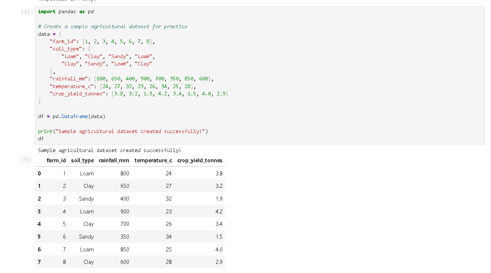
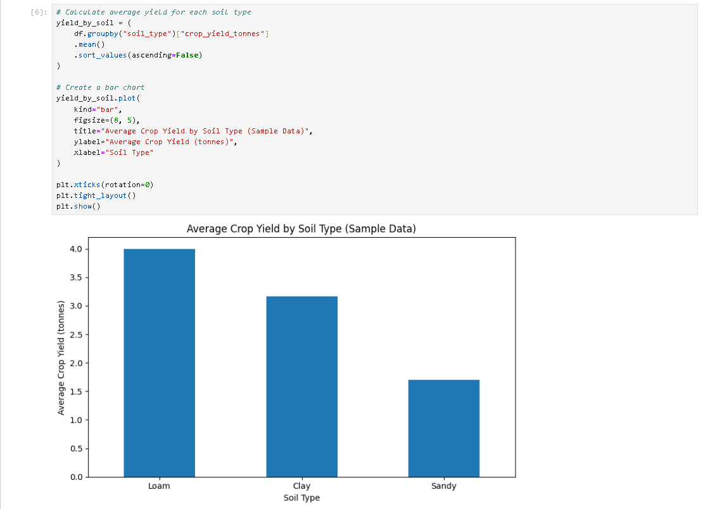
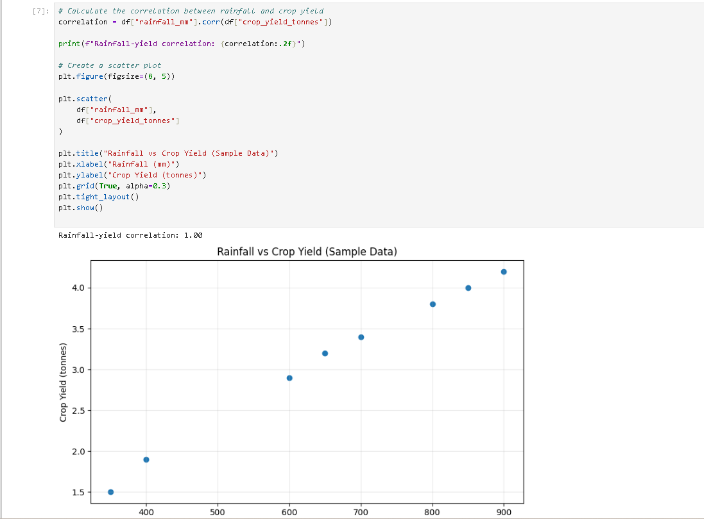

# Maji Ndogo Agricultural Data Analysis

## Business Problem

Agricultural data analysis can help people explore farming conditions, identify patterns, and ask better questions about crop production.

This project demonstrates an exploratory data analysis workflow using Python. A small, illustrative agricultural dataset is used to practice examining rainfall, temperature, soil types, and crop yields.

**Data transparency:** The dataset in this practice project is manually created sample data. It is not the original Maji Ndogo dataset, and the results should not be interpreted as official findings about Maji Ndogo agriculture.

## Tech Stack

- **Python** — data analysis and programming
- **Pandas** — data manipulation and descriptive statistics
- **Matplotlib** — data visualization
- **Jupyter Notebook** — interactive analysis and documentation

## Deliverable

A reproducible exploratory data analysis workflow demonstrating how to:

- Inspect the structure and dimensions of a dataset.
- Check for missing values.
- Generate descriptive statistics.
- Compare average crop yield across soil types.
- Explore the relationship between rainfall and crop yield using a correlation coefficient and scatter plot.

The project includes screenshot evidence of the dataset, the crop-yield comparison, and the rainfall-versus-yield visualization.

## Key Insights

Within the eight-row sample dataset:

- Loam soil has the highest average crop yield among the three soil types represented.
- Sandy soil has the lowest average crop yield among the three soil types represented.
- Rainfall and crop yield were compared using correlation and a scatter plot to explore their linear relationship.

These observations describe only the illustrative sample. The small dataset cannot support broad conclusions about real farms or establish that a particular condition causes higher crop yield.

## So What?

This practice project demonstrates foundational skills in data inspection, data quality checks, descriptive analysis, visualization, and evidence-based communication.

The workflow illustrates how an analyst can move from raw tabular data to clear exploratory questions and visual evidence. Applying these methods to authentic, sufficiently large agricultural data would be a necessary next step before making real-world recommendations.

## Limitations and Next Steps

- Replace the illustrative sample with an authorized, authentic agricultural dataset.
- Investigate data quality and the meaning of each variable.
- Explore additional factors that may be associated with crop yield.
- Validate observed patterns before communicating recommendations.

## Evidence

### 1. Dataset Overview

The sample dataset contains eight records and five columns describing soil type, rainfall, temperature, and crop yield.

### 2. Crop Yield by Soil Type

This chart compares average crop yield across the soil types represented in the illustrative sample dataset.

### 3. Rainfall and Crop Yield

This scatter plot explores the relationship between rainfall and crop yield in the sample data.

*All screenshots show illustrative practice data, not official Maji Ndogo findings.*
